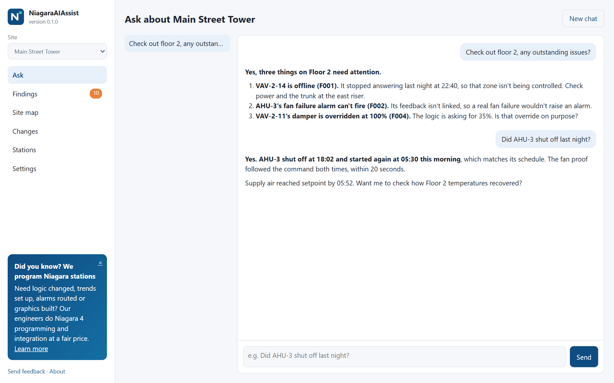
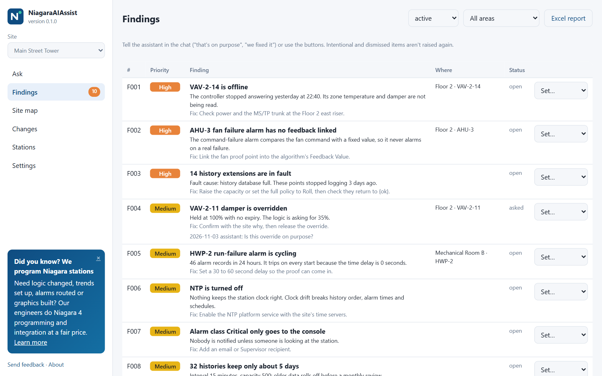
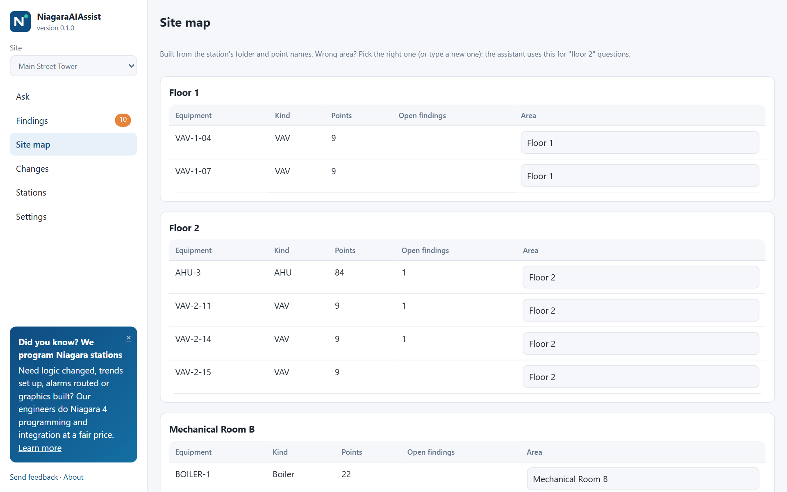
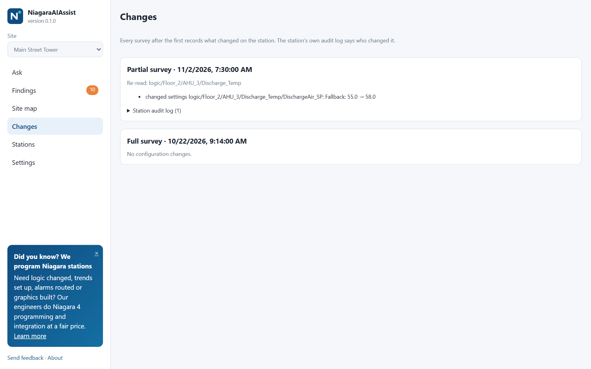
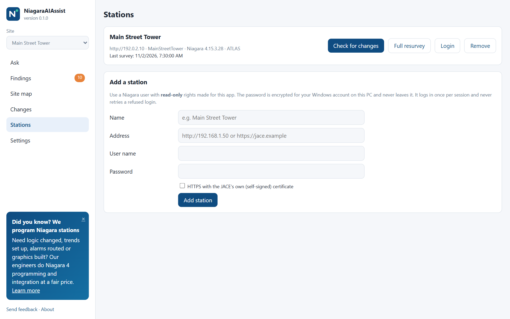

# NiagaraAIAssist

**Ask your Niagara building system questions in plain English.** Free for Windows.

- "Check out floor 2, any outstanding issues?"
- "Look at AHU-3: did it shut off last night?"
- "Is any alarm in the system cycling?"

NiagaraAIAssist surveys your Niagara 4 station (JACE or Supervisor) once, keeps what it learned on your PC, and answers
through your own Claude Code account. It also lists findings (Critical to Info) with the fix for each, asks you when
something might be on purpose, and remembers your answers.

## Screens

| | |
|---|---|
| **Findings, with the fix for each**  | **Equipment by floor and room**  |
| **What changed, and who changed it**  | **Your stations**  |

*These screens show a made-up demo site, and the conversation is a written example, not a recorded answer.*

## Read-only, always

It logs in through the station's own login page and only ever sends GET requests. There is no write code in the app:
it can't change, override or acknowledge anything. We still recommend a dedicated read-only Niagara user for it.

## Survey once

After the first survey (a minute or two on a JACE) it only checks whether the system changed, using the station's own
counts and audit log. If someone changed something, it re-reads just that part and shows you what changed and who did
it. A full resurvey is only needed after an upgrade or a large change.

## What you need

- Windows 10 or 11 on a PC that can reach the station's web server
- Chrome or Edge
- **[Claude Code](https://claude.com/claude-code)**, installed and logged in with your own Claude account (Pro or Max).
  No API key. Open a terminal, run `claude` once and log in.

## Install

1. Download the latest `NiagaraAIAssist-x.y.z.msi` from [Releases](../../releases/latest). No admin rights needed.
   Windows SmartScreen may warn because the installer isn't code-signed yet: choose **More info → Run anyway**.
2. Look for the **N** icon by the clock: green means running. Click it to open the app.
3. **Stations → Add a station**: address, read-only user, password. The survey starts by itself.
4. Go to **Ask**.

Updates install automatically.

## Your data

- **On your PC:** the survey, findings, chats (`%LOCALAPPDATA%\NiagaraAIAssist`). The station password is encrypted for
  your Windows account and is never sent anywhere except to your station's login page.
- **Sent to Claude, on your account:** your questions and the station data the assistant reads to answer them.
- **Nothing is sent to us.** The app contacts this GitHub repo for updates and news, your station, and your Claude Code.

## Services

Need more than answers? We offer **Niagara engineering and programming** and **low-cost preventive maintenance plans**.
Contact: http://www.baclogic.com

## Ideas and problems

[Ask for a feature or report a problem](../../issues/new/choose), or use **Send feedback** in the app.
